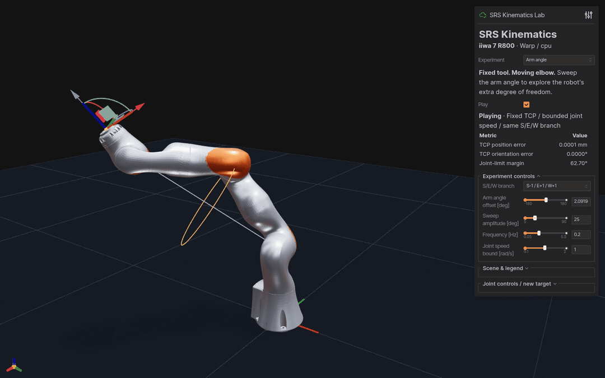

# 7DofSRSKinematicsWarp

中文 | [English](README_EN.md) · [NumPy 参考实现](https://github.com/chase6305/7DofSRSKinematics)

基于 NVIDIA Warp 的 7 自由度 S-R-S 解析运动学，提供 Torch 批量接口与 CPU 回退。



- GPU 批量 FK / IK、解析雅可比和八种肩肘腕分支。
- 与 NumPy 参考实现交叉校验，内置一致的 KUKA iiwa 7 R800 模型。
- 五种交互实验、PBR 机器人资产与 CSV 运动导出。

## 运行演示

Python 3.10+：

```bash
python -m pip install -e '.[viewer]'
srs-warp-lab --backend warp --device cpu --autoplay
```

打开 **http://127.0.0.1:8081**，通过 Experiment 切换实验。
可用 `--device cuda` 运行 FK / 雅可比；实验室的精确构型 IK 在 CPU 上计算。

| 实验 | 看点 |
|:--|:--|
| Arm angle | TCP 固定，肘部沿圆周自运动 |
| Eight branches | 八种 S/E/W 构型的机器人模型并列展示 |
| Jacobian | 速度椭球与固定 TCP 的关节居中 |
| TCP trajectory | 直线、圆、8 字路径与实际轨迹对照 |
| Self-motion manifold | 固定 TCP 的关节空间分支曲线 |

[截图、控制方式与 CSV 导出 →](docs/demos.md)

## Python API

```python
import torch
from srs_solver import KUKAiiwaSolver

solver = KUKAiiwaSolver(device="cpu")
q = torch.tensor([[0.3, -0.5, 0.7, 1.0, -0.4, 0.8, -0.2]])
target = solver.get_fk(q)
ok, joints = solver.get_ik(target, torch.zeros_like(q))
print(joints[ok, 0])  # valid rows, shape (N_valid, 7), radians
```

`ok` 为 `(N,)`，最近解为 `(N, 1, 7)`，使用前先检查成功标志。
[完整批量接口与数值约定 →](docs/api.md)

## 验证与 GPU 基准

```bash
python -m pip install -e '.[dev]'
python -m pytest -q
srs-warp-lab --validate-only --backend warp --device cpu
srs-parallel-demo --device cuda --batch-size 4096 --num-samples 73 --repeats 20
```

- [交互实验与录制](docs/demos.md) · [API](docs/api.md)
- [测试、基准与 NumPy 对照](docs/development.md)
- [R800 资产、PBR 材质与 iiwa14 参考分析](docs/assets.md) · [资产许可证](urdf/ASSET_LICENSE)
