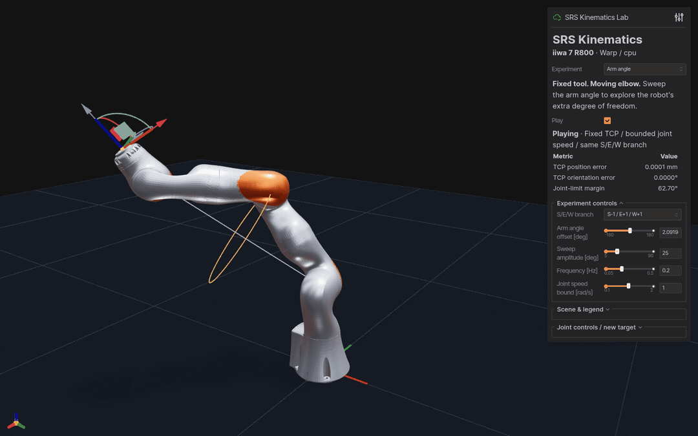

# 7DofSRSKinematicsWarp

[中文](README.md) | English · [NumPy reference](https://github.com/chase6305/7DofSRSKinematics)

NVIDIA Warp analytical kinematics for 7-DoF S-R-S arms, with a Torch batch API
and CPU fallback.



Fixed-TCP self-motion → figure-eight tracking. Ten seconds of actual Warp/CPU playback.

- GPU batched FK / IK, analytical Jacobians and all eight S/E/W branches.
- Cross-checked against NumPy, with the same bundled KUKA iiwa 7 R800 model.
- Five interactive experiments, PBR robot assets and CSV motion export.

## Run the demo

Python 3.10+:

```bash
python -m pip install -e '.[viewer]'
srs-warp-lab --backend warp --device cpu --autoplay
```

Open **http://127.0.0.1:8081** and select an Experiment. Use `--device cuda`
for FK / Jacobians on CUDA; exact configuration IK in the lab runs on CPU.

| Experiment | What to watch |
|:--|:--|
| Arm angle | Elbow motion with a fixed TCP |
| Eight branches | Eight S/E/W robot configurations side by side |
| Jacobian | Velocity ellipsoid and fixed-TCP joint centering |
| TCP trajectory | Line, circle and figure-eight references versus actual FK |
| Self-motion manifold | Fixed-TCP branches projected into joint space |

[Screenshots, controls and CSV export →](docs/demos.md)

## Python API

```python
import torch
from srs_solver import KUKAiiwaSolver

solver = KUKAiiwaSolver(device="cpu")
q = torch.tensor([[0.3, -0.5, 0.7, 1.0, -0.4, 0.8, -0.2]])
target = solver.get_fk(q)
ok, joints = solver.get_ik(target, torch.zeros_like(q))
print(joints[ok, 0])  # valid rows, shape (N_valid, 7), radians
```

Success has shape `(N,)`; nearest solutions have shape `(N, 1, 7)`. Always mask
failed rows. [Batch APIs and numerical conventions →](docs/api.md)

## Validation and GPU benchmark

```bash
python -m pip install -e '.[dev]'
python -m pytest -q
srs-warp-lab --validate-only --backend warp --device cpu
srs-parallel-demo --device cuda --batch-size 4096 --num-samples 73 --repeats 20
```

- [Experiments and recordings](docs/demos.md) · [API](docs/api.md)
- [Tests, benchmarks and NumPy comparison](docs/development.md)
- [R800 assets, PBR finishes and the iiwa14 reference](docs/assets.md) · [Asset license](urdf/ASSET_LICENSE)
