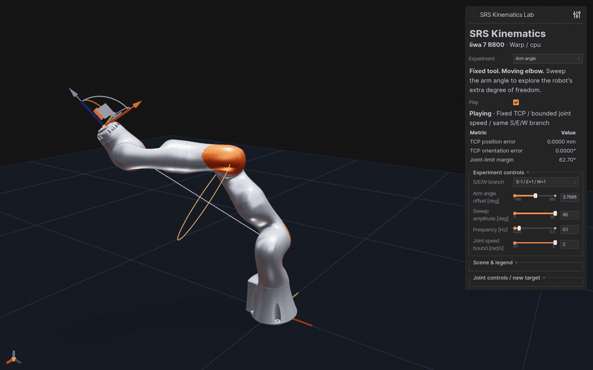
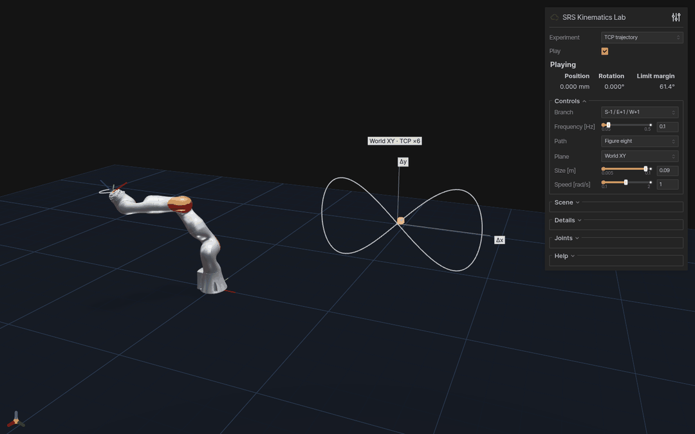

# 7DofSRSKinematicsWarp

[English](README.md) | 简体中文 · [NumPy 版本](https://github.com/chase6305/7DofSRSKinematics)

基于 NVIDIA Warp 与 PyTorch 的 7 自由度 S-R-S 解析运动学，支持 GPU 批量计算。
内置 KUKA iiwa 7 R800 示例。

- 解析 FK / IK、八种肩肘腕分支与臂角控制。
- 批量连杆位姿、雅可比与零空间运动。
- 交互演示和 CSV 导出。

## Demo

### 固定 TCP 自运动 · 臂角 ±90°



### 8 字轨迹跟踪 · 180 × 90 mm



两段运行中的 viewer 实录，每段 10 秒。

## 快速开始

Python 3.10+：

```bash
python -m pip install -e '.[viewer]'
srs-warp-lab --demo arm-angle --amplitude 90 --joint-speed 2 --autoplay
# 或运行 8 字轨迹：
srs-warp-lab --demo trajectory --path-size 0.09 --autoplay
```

打开 <http://127.0.0.1:8081>，选择实验并切换 **Play**。
侧栏还提供八种构型、雅可比速度椭球和自运动流形。
[操作说明与 CSV 导出](docs/demos.md)。

## Python API

```python
import torch
from srs_solver import KUKAiiwaSolver

solver = KUKAiiwaSolver(device="cpu")  # use "cuda" for GPU batches
q = torch.tensor([[0.3, -0.5, 0.7, 1.0, -0.4, 0.8, -0.2]])
target = solver.get_fk(q)
ok, joints = solver.get_ik(target, torch.zeros_like(q))
print(joints[ok, 0])  # successful rows, radians
```

批量形状、坐标系与限位约定见 [API 文档](docs/api.md)。

## Benchmark

RTX 5090 D v2、Warp 1.16，73 个臂角样本的全局 IK：

| 批量大小 | 中位耗时 |
| ---: | ---: |
| 64 | 0.245 ms |
| 4096 | 0.480 ms |

预热后的完整调用，包含校验和选解，不包含编译。
[原始结果](docs/benchmarks/global-ik.json)。

```bash
srs-parallel-demo --device cuda --batch-size 4096 --num-samples 73
```

## 参考论文

- Shimizu et al. (2008). [Analytical Inverse Kinematic Computation for 7-DOF
  Redundant Manipulators With Joint Limits and Its Application to Redundancy
  Resolution](https://doi.org/10.1109/TRO.2008.2003266).
  *IEEE Transactions on Robotics*, 24(5), 1131–1142.
- Faria et al. (2018). [Position-based kinematics for 7-DoF serial manipulators
  with global configuration control, joint limit and singularity
  avoidance](https://doi.org/10.1016/j.mechmachtheory.2017.10.025).
  *Mechanism and Machine Theory*, 121, 317–334.

本实现采用论文的臂角参数化思路，臂角选择使用有限采样，并未完整实现解析可行区间构造。
详见 [实现差异](docs/paper-comparison.md)。
