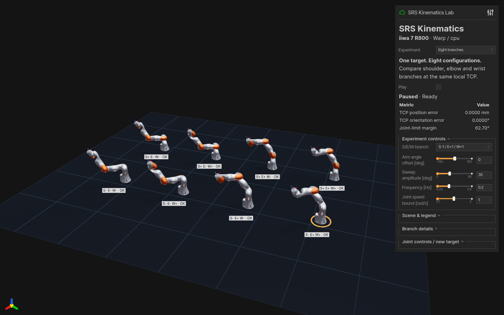
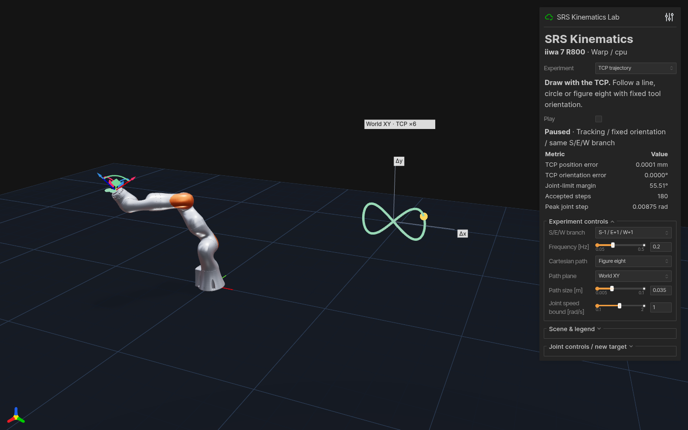
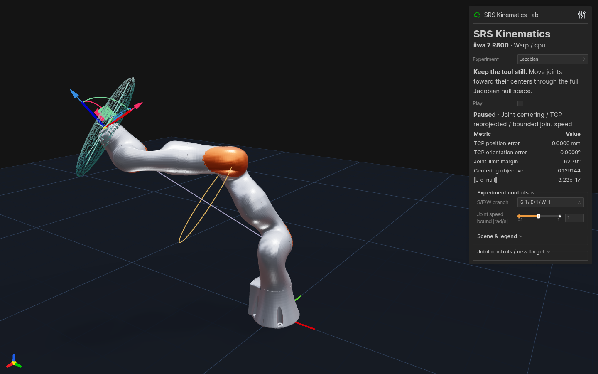
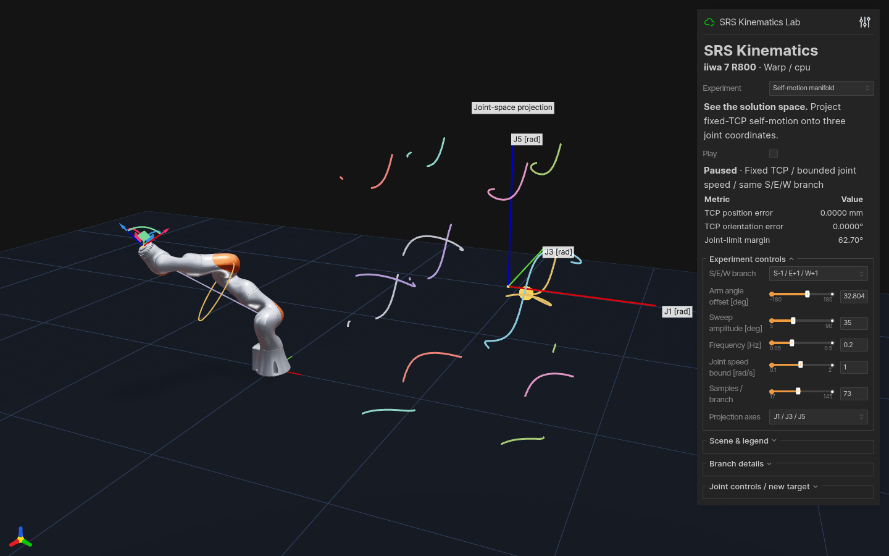

# Interactive experiments

Install `.[viewer]`, then select one of five experiments (also switchable in the page):

```bash
srs-warp-lab --demo arm-angle --backend warp --device cpu --port 8081
srs-warp-lab --demo branches --backend warp --device cpu --port 8082
srs-warp-lab --demo jacobian --backend warp --device cpu --port 8083
python -m example.viser_trajectory_demo --backend warp --device cpu --port 8084
python -m example.viser_manifold_demo --backend warp --device cpu --port 8085
```

From a checkout, use `python -m example.viser_srs_lab` with the same options. The NumPy repository offers the corresponding `srs-viser-lab` with the same experiment model and controls.

| Mode | Experiment |
|:--|:--|
| `arm-angle` | Fixed-TCP arm-angle sweep with S/E/W markers, shoulder–wrist axis and geometric elbow circle. Infeasible angles retain the last feasible pose and show a message. |
| `branches` | Eight S/E/W branches, availability and minimum joint-limit margin. Display tiles are translated; their local target and arm angle are identical. |
| `jacobian` | Linear velocity ellipsoid and null-space joint centering. Each descent step is corrected back to the exact TCP target on the selected branch. |
| `trajectory` | Fixed-orientation line, circle and figure-eight tracking on the same S/E/W branch, with a gray reference, green FK trace and joint-step/error metrics. |
| `manifold` | Eight fixed-TCP self-motion branches projected onto J1/J3/J5, with infeasible intervals and large joint jumps broken, and a current-configuration marker. |

Trajectory controls select the path, plane, size and joint-speed bound. Path plane offers world XY/XZ/YZ and TCP-local XY, using the TCP orientation at the start. Changing the path, plane or size starts a new reference from the current TCP. Progress slows near constraints and pauses at the last feasible pose if no valid step remains; actual frequency can be lower than the reference frequency. Pause to drag the TCP gizmo. The right plot magnifies displacement along the selected plane axes by six.

All automatic playback modes respect Joint speed bound using direct joint differences per frame, without wrapping away full turns. Up to 12 progressively halved steps let fast arm-angle sweeps and slow Cartesian paths reduce progress before pausing with the last feasible pose and phase intact. Self-motion playback stops at failed steps instead of continuing its sweep to a distant feasible angle. Manual joint, branch and arm-angle controls select poses directly; changing sweep amplitude recenters playback at the current arm angle.

Pausing and resuming preserves the sweep phase, center and direction. Pose, branch, arm-angle, amplitude or experiment changes start a new sweep.

The CLI also accepts `--path`, `--plane`, `--path-size`, `--preset`, `--frequency`, `--joint-speed` and `--amplitude`. Export reproducible playback without installing Viser:

```bash
python -m example.viser_trajectory_demo --backend warp --device cpu --plane tool-xy --path circle --path-size 0.015 --autoplay
python -m example.viser_trajectory_demo --backend warp --device cpu --plane world-xz --path circle --path-size 0.015 --frames 300 --fps 30 --export-csv trajectory.csv
python -m example.viser_manifold_demo --backend warp --device cpu --frames 300 --fps 30 --export-csv self_motion.csv
```

CSV includes the initial pose and each accepted step: simulated time, seven joint angles, actual/target world TCP positions and rotation matrices, pose errors, joint-limit margin, peak joint speed, phase, arm angle and S/E/W branch. Positions are in meters, angles in radians, and matrices are flattened by row. `--fps` accepts 20–240; export uses fixed simulation time steps of `1/fps`, independent of computation time. All five modes export the selected robot. Early pauses retain accepted rows and return exit code 2 with a reason in the JSON report. Existing files are preserved; `--validate-only` and `--export-csv` are mutually exclusive.

Projection axes switches the manifold between J1/J3/J5, shoulder J1/J2/J3, wrist J5/J6/J7 and J2/J4/J6. Curves update only when the target, sampling resolution or projection changes; playback updates the current marker.

Samples / branch sets manifold resolution. Its coordinates are joint angles in radians, rendered at scale 0.22; crossings in the projection need not be identical seven-joint configurations. Finite sampling can miss narrow feasible intervals. Arm angle and Play drive the robot and the current joint-space marker together.

Drag the TCP gizmo to set a target; use joint controls or Pose preset to reset it. Play starts arm-angle sweeps or joint centering. `--autoplay` starts immediately, `--no-mesh` shows only geometry, and `--device cuda` selects an available CUDA device. `--backend numpy --device cpu` uses the batch CPU fallback. The server defaults to `127.0.0.1`.

FK, batched link poses and Jacobians use the selected backend. Exact branch/arm-angle IK and null-space projection in this interactive lab run on the CPU. Paused idle scenes do not recompute or redraw.

Consecutive drag samples from one control are coalesced on insertion. Different controls, reset and mode changes preserve their order so coalescing cannot silently change the TCP target. Rendering and diagnostics share link poses; self-motion reuses the previous frame's Jacobian. Branch IK and link poses are cached by target and arm angle. Automatic stops immediately refresh the final status. The NumPy reference now also accepts batched `get_all_fk_mat` inputs, covered by the cross-repository tests.

The orange elbow circle is a geometric locus; joint limits can exclude parts of it. The ellipsoid shows translational velocity for unit joint-speed norm (display scale 0.25), **with orientation unconstrained**. Actual self-motion uses the full `6×7` Jacobian. Joint centering is local descent, without a global optimality guarantee.

Headless validation requires only core dependencies and checks all five experiments, limits, separate position/rotation residuals and objective descent:

```bash
python -m example.viser_srs_lab --validate-only --backend numpy
python -m example.viser_srs_lab --validate-only --backend warp --device cpu
```

### Run the parallel FK/IK benchmark

The demo builds a batch of reachable poses with FK, solves them together, and
reports throughput and round-trip error. CUDA is selected automatically when
available.

```bash
conda activate hmotion
srs-parallel-demo --device cuda --batch-size 4096 --num-samples 73 --repeats 20
```

For a functional CPU smoke test:

```bash
srs-parallel-demo --device cpu --backend warp --batch-size 64 --num-samples 73 --repeats 10
```

`--backend auto` selects Warp for CUDA and the NumPy fallback for CPU.
`--backend warp` also runs the complete Warp pipeline on CPU, which is useful
for CI, profiling and machines without a visible GPU.

The reference repository's null-space example also has a batched counterpart:

```bash
srs-null-space-demo --device cuda --backend warp --batch-size 4096 --repeats 20
```

## Scene controls

The compact panel keeps Play and live TCP error visible. Experiment controls
change with the selected mode; pose presets and individual joints are under
**Joint controls / new target**. Open **Scene & legend** to toggle meshes,
geometry guides and joint labels, or reset your camera. **Reset view** affects
only your own browser; mode changes frame the new experiment for all clients.
The eight-branch view loads its robot meshes on first use; hidden or unavailable
branches do not display a robot. `--no-mesh` keeps the geometry-only view.

Fixed trajectory reference lines are built when the path changes. During
playback only the actual trace and current marker are rebuilt. Changing the
path, plane, size, pose or TCP immediately rebuilds the reference.

## Recorded views

These are captures of the running Viser app with the bundled R800 model.

| Eight S/E/W branches | Cartesian tracking |
|:--|:--|
|  |  |

| Jacobian null space | Self-motion manifold |
|:--|:--|
|  |  |


The [capture manifest](media/capture.json) records the backend, Viser version,
simulation rate, pose residuals and joint-speed bound for the actual recording.
The five-second GIF uses a 25° sweep at 0.2 Hz, recorded at 15 fps; it is not a
measurement of solver or rendering throughput. Still images are 1440×900.

Scene visibility is refreshed after experiment or display edits. Playback
updates the moving geometry; hidden branch robots are not toggled every frame.
